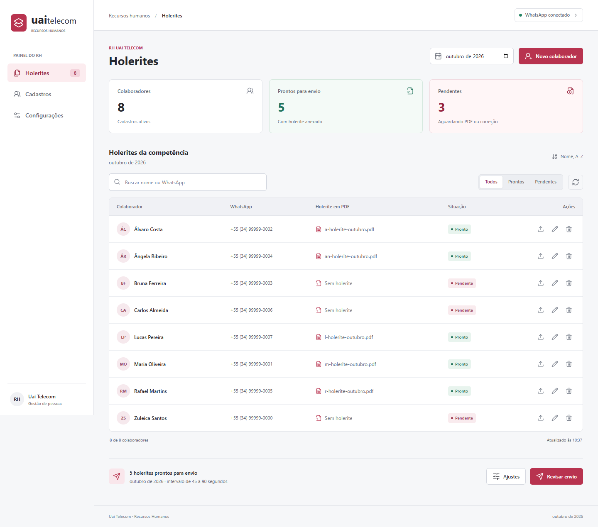

# WP RH Holerite Sender


Painel web para o RH cadastrar colaboradores, anexar holerites em PDF e enviar documentos pelo WhatsApp com conferência prévia, delay configurável e relatório de envio.

> Criado para transformar um processo mensal manual em uma rotina mais rápida, rastreável e organizada.

## Destaques



- Cadastro e manutenção de colaboradores pela interface web.
- Ordem alfabética automática em português após cadastrar ou editar nomes.
- Navegação por Holerites, Cadastros e Configurações, adaptada para celular.
- Upload de holerite em PDF por colaborador e por mês.
- Conferência visual de pendências antes do disparo.
- Envio em lote via WhatsApp com sessão autenticada por QR Code.
- Mensagem personalizada com variáveis como `{nome}` e `{mes}`.
- Delay aleatório configurável entre envios para reduzir comportamento agressivo.
- Relatório CSV com sucesso, falha, motivo e identificador da mensagem.
- Proteção para não versionar PDFs reais, relatórios, sessões ou `node_modules`.

<details>
<summary><strong>Fluxo de uso</strong></summary>

1. Inicie o painel.
2. Em `Configurações`, conecte o WhatsApp e ajuste mensagem e intervalo de envio.
3. Em `Cadastros`, use `Novo colaborador` ou o ícone de editar.
4. Em `Holerites`, escolha a competência.
5. Use o ícone de upload na linha do colaborador e anexe o PDF.
6. Confira os filtros `Prontos` e `Pendentes` ou busque pelo nome e WhatsApp.
7. Clique em `Revisar envio`.
8. Confira os dados e confirme o envio.
9. Consulte o relatório gerado ao final.

</details>

## Tecnologias

| Camada | Uso |
| --- | --- |
| Node.js | Runtime da aplicação |
| Express | Servidor web e API local |
| Baileys | Integração com WhatsApp Web |
| Multer | Recebimento dos PDFs |
| CSV local | Base simples de colaboradores e relatórios |

## Como Rodar

```bash
npm install
npm start
```

Para validar a ordenação e o cadastro pela API com dados isolados:

```bash
npm test
```

Depois acesse:

```text
http://localhost:3000
```

## Estrutura

```text
.
|-- server.js
|-- public/
|-- Planilha/
|   |-- colaboradores.csv
|   `-- relatorios-holerites/
|-- Holerites/
|-- auth_info/
|-- package.json
`-- README.md
```

## Pastas Importantes

| Caminho | Descrição |
| --- | --- |
| `Planilha/colaboradores.csv` | Base local de colaboradores |
| `Holerites/` | PDFs organizados por mês |
| `Planilha/relatorios-holerites/` | Relatórios CSV de envio |
| `auth_info/` | Sessão local do WhatsApp |

## Segurança

Este projeto pode lidar com dados pessoais, números de telefone, sessões do WhatsApp e holerites. Antes de publicar ou compartilhar:

- não suba holerites reais;
- não versione `auth_info/`;
- não versione relatórios com dados pessoais;
- revise planilhas de exemplo;
- use apenas para comunicação legítima com colaboradores.

## Checklist

- [ ] WhatsApp conectado por QR Code.
- [ ] Colaboradores revisados.
- [ ] Holerites conferidos.
- [ ] Mensagem validada.
- [ ] Delay definido.
- [ ] Relatório salvo após o envio.
